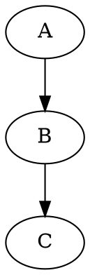
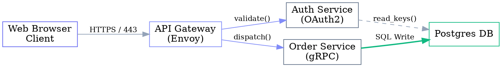
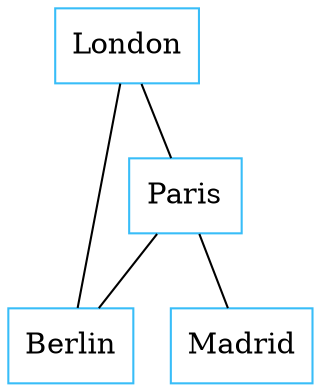
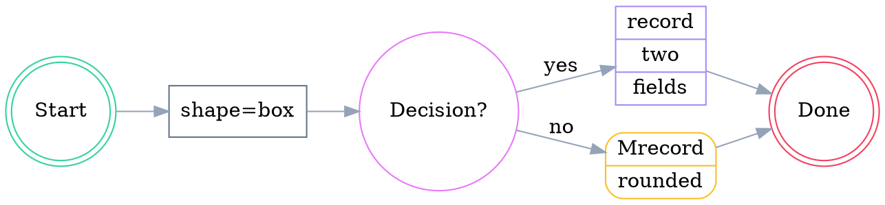
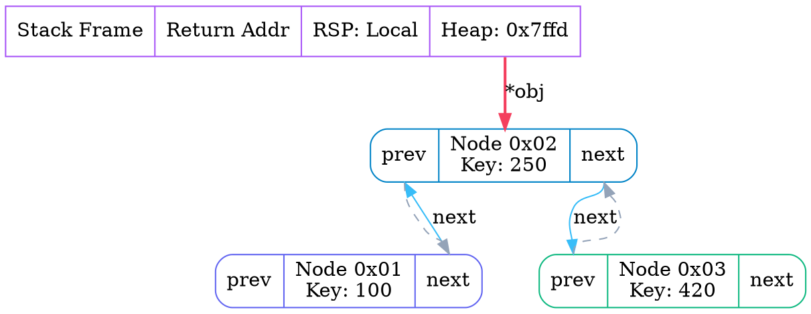
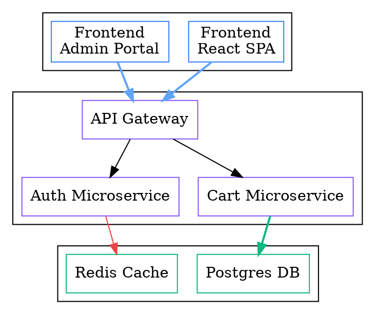
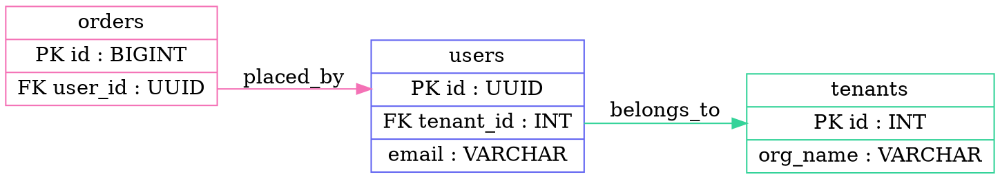
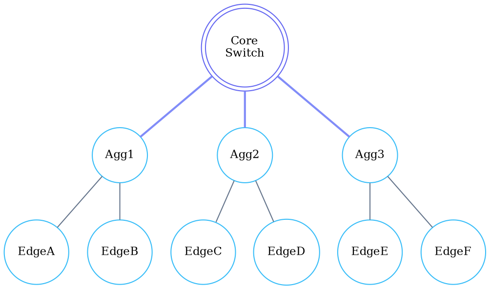
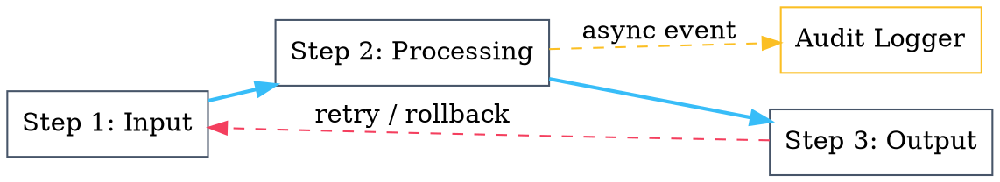
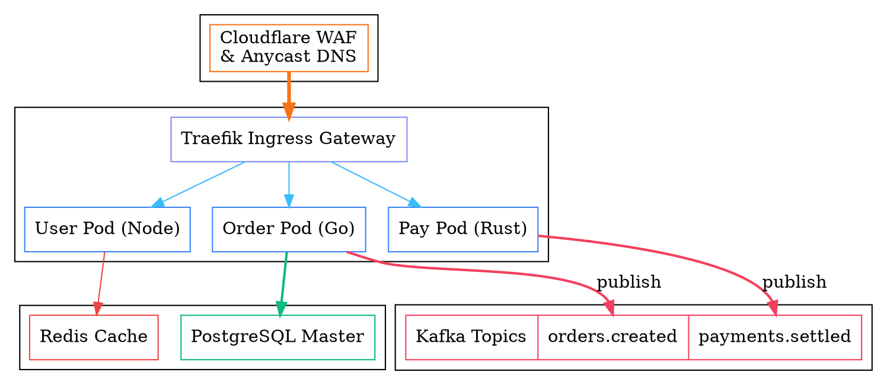

# Graphviz & DOT Reference Manual

A hands-on guide to **Graphviz** and the **DOT language**, with live diagrams rendered by Notezilla.

---

## How to Render Graphviz in Notezilla

Wrap DOT source in a fenced code block with the `graphviz` language tag:

````markdown

````


Notezilla lays diagrams out with a built-in hierarchical (`dot`-style) engine. It supports the core DOT language plus the attributes below. Anything else is parsed and then ignored, so a diagram written for desktop Graphviz still renders, just with less styling.

| Area | Supported in Notezilla |
| :--- | :--- |
| Graph types | `digraph`, `graph`, `strict`, `subgraph`, anonymous `{ ... }` scopes |
| Graph attributes | `rankdir=TB` (default) and `rankdir=LR` |
| Node shapes | `circle` (default), `box`, `doublecircle`, `record`, `Mrecord` |
| Node attributes | `label` (with `\n` line breaks), `color`, `fillcolor`, `style=filled`, `fontsize` |
| Edge operators | `->` (arrow), `--` (plain line), chains such as `A -> B -> C` |
| Edge attributes | `label`, `color`, `style=dashed`, `penwidth` (whole numbers), `fontsize` |
| Ports | `Node:port` on `record` / `Mrecord` fields |

Text is drawn in the editor's theme colour, so outline colours (`color`) read well in both light and dark themes. Fill colours (`fillcolor`) may not.

---

## Chapter 1: Graph Types, Direction & Core Syntax

Graphviz documents are written in the **DOT language**. Every graph is declared as either directed or undirected.

### Key Rules
1. **`digraph { ... }`**: Directed graph using the `->` edge operator. Used for workflows, pipelines, call graphs, and state machines.
2. **`graph { ... }`**: Undirected graph using the `--` edge operator. Used for symmetric relationships and networks.
3. **`strict` modifier**: `strict digraph` or `strict graph` is accepted. Desktop Graphviz uses it to merge duplicate edges.
4. **Global Directives**: Defaults can be set for every following statement with `graph [...]`, `node [...]`, and `edge [...]`.
5. **Rank Direction (`rankdir`)**: `TB` (top-to-bottom, default) or `LR` (left-to-right). Desktop Graphviz also offers `BT` and `RL`.

### Directed Graph with Global Defaults

A web service architecture flowing left to right. Node and edge defaults are declared once, then overridden per element.



### Undirected Graph

The same keywords with `graph` and `--` produce lines without arrowheads.



---

## Chapter 2: Node Shapes & Styles

Desktop Graphviz supports over 40 shapes, including `ellipse`, `diamond`, `cylinder`, `component`, `folder`, `note`, `hexagon`, and parametric `polygon` shapes. Notezilla draws the shapes below and falls back to `circle` for any other shape name.

### Essential Node Attributes
* `shape`: `circle`, `box`, `doublecircle`, `record`, `Mrecord`.
* `label`: Display text. `\n` starts a new line. Defaults to the node name.
* `color`: Outline colour, as a name (`red`) or hex value (`"#e879f9"`).
* `style=filled` with `fillcolor`: Fills the shape background.
* `fontsize`: Label size in points.

### Shape Gallery

A small decision flow that uses every supported shape.



---

## Chapter 3: Record Shapes & Port Targeting

**Record shapes** (`shape=record` and `shape=Mrecord`) split a node into compartments. They suit data structures, memory frames, structs, and linked lists. `Mrecord` draws rounded corners.

### Syntax Rules
* **Dividers (`|`)**: Separate fields along the current axis.
* **Flipping Axis (`{ ... }`)**: Nested braces alternate between horizontal and vertical slicing.
* **Port Names (`<portName>`)**: Prefixing field text with `<portName>` registers a named edge anchor.
* **Edge Pinning (`Node:port`)**: Routes an edge to a named field rather than the node's centre.

### Doubly-Linked List & Stack Frame

Linked list nodes with `<prev>`, `<data>`, and `<next>` ports, and a stack frame whose `<ptr>` field points into the list.



---

## Chapter 4: Edge Styles & Direction

Edges carry most of a diagram's meaning: direction, strength, and kind of relationship.

### Edge Attributes
* `->` draws an arrowhead at the target; `--` draws a plain line. Both can be mixed inside a `digraph`.
* `style=dashed`: Dashed line, often used for optional, weak, or asynchronous relationships.
* `penwidth`: Line thickness as a whole number (`1`, `2`, `3`, ...), used to show strength or volume.
* `color`: Line colour, used to group related edges.
* `label`: Text placed beside the edge midpoint, for example a call name or a UML multiplicity such as `1 : 0..*`.

Desktop Graphviz adds `arrowhead` / `arrowtail` shapes (`crow`, `diamond`, `tee`, `dot`, ...), `dir=both`, `style=tapered`, and `taillabel` / `headlabel`. Notezilla parses these and ignores them.

### Line Taxonomy

```graphviz
digraph EdgeTaxonomy {
  graph [rankdir=LR];
  node  [shape=circle, color="#475569", fontsize=11];

  S1 -> T1 [label="arrow (->)", color="#60a5fa"];
  S2 -- T2 [label="line (--)", color="#34d399"];
  S3 -> T3 [label="dashed", style=dashed, color="#f472b6"];
  S4 -> T4 [label="penwidth=3", penwidth=3, color="#fbbf24"];
  S5 -> T5 [label="1 : 0..*", style=dashed, color="#38bdf8"];
}
```

---

## Chapter 5: Subgraphs & Attribute Scope

Subgraphs group statements. In desktop Graphviz they serve two purposes: **visual grouping** (a subgraph named `cluster_*` gets a surrounding box) and **rank constraints** (`{ rank=same; A; B; }` puts nodes on one level).

### Rules
1. **Scoped defaults**: A `node [...]` or `edge [...]` statement inside a subgraph applies only to that subgraph. This works in Notezilla and is the simplest way to style a group consistently.
2. **Clusters**: Notezilla accepts `subgraph cluster_name { ... }` but does not draw the cluster box. Give each group a shared outline colour so it still reads as one tier.
3. **Ranking & compound edges**: `rank=same`, `compound=true`, `lhead`, and `ltail` are parsed and ignored.

### Multi-Tier Architecture

The frontend, microservice, and persistence tiers each set their own node colour inside their subgraph.



---

## Chapter 6: Relational Schemas with Records

Desktop Graphviz supports **HTML-like labels** (`label=< <table>...</table> >`) for rich tables with fonts and per-cell ports. Notezilla does not support HTML-like labels. Record shapes describe the same structure: one field per column, with a port on each key column.

### Field Layout
* In a `rankdir=LR` graph, top-level `|` fields stack vertically, so each field becomes a table row.
* Prefix key columns with `<port>` so relationships can connect to the exact row.
* Write the key kind (`PK` / `FK`) and type in the field text.

### Database ERD with Column-Level Ports



---

## Chapter 7: Layout Engines

Desktop Graphviz is a suite of layout solvers. The same DOT description can be laid out by different engines:

| Engine | Mathematics | Primary Use Case |
| :--- | :--- | :--- |
| **`dot`** | Sugiyama Hierarchical Layering | Directed graphs, state machines, workflows |
| **`neato`** | Stress Majorization / Kamada-Kawai Spring | Undirected graphs up to ~100 nodes |
| **`fdp`** | Fruchterman-Reingold Spring-Electrical | Force-directed graphs with clusters |
| **`sfdp`** | Multiscale Force-Directed | Massive networks (10,000+ nodes) |
| **`twopi`** | Radial Layout with Concentric Rings | Tree-like networks with a clear root node |
| **`circo`** | Circular Biconnected Component Topology | Ring topologies, telecommunications |

Notezilla always uses the hierarchical `dot`-style layout, and the `layout=` attribute is ignored. Desktop `twopi` would arrange the network below in rings around the core switch. In Notezilla the same tree is drawn in levels, with the root at the top.

### Network Topology as a Hierarchy



---

## Chapter 8: Feedback Loops & Side Channels

Real pipelines loop back on themselves. A layout engine has to place nodes in order while still drawing edges that point backwards.

### Behaviour
1. **Back edges**: An edge from a later node to an earlier one (`Stage3 -> Stage1`) is drawn without breaking the forward order of the pipeline.
2. **Side channels**: Nodes that hang off the main flow, such as loggers and audit sinks, are placed on the next level.
3. **Desktop-only tuning**: Compass anchors (`Node:s`, `Node:ne`), `constraint=false`, `splines=ortho`, and `style=invis` spacers are parsed and ignored. Notezilla places and routes edges automatically.

### Pipeline with Rollback

A three-step pipeline with a dashed rollback edge and an asynchronous audit side channel.



---

## Chapter 9: Putting It Together: Cloud Microservices Architecture

An end-to-end cloud platform that combines scoped subgraph styling, record ports, labelled and weighted edges, and colour-coded tiers.



---

## Chapter 10: CLI Tooling, Compilation & Automation

Outside Notezilla, the desktop Graphviz toolchain renders the same DOT files with every engine and attribute described above.

### Command-Line Compilation
```bash
# Render directly to vector SVG
dot -Tsvg input.dot -o output.svg

# Render high-resolution raster PNG (300 DPI)
dot -Tpng -Gdpi=300 input.dot -o output.png

# Render vector PDF
dot -Tpdf input.dot -o architecture.pdf

# Using alternative layout engines via CLI
neato -Tsvg network.dot -o network.svg
twopi -Tsvg topology.dot -o topology.svg
circo -Tsvg ring.dot -o ring.svg
fdp   -Tsvg clusters.dot -o clusters.svg
```

### Python SDK Integration (`graphviz`)
```python
import graphviz

dot = graphviz.Digraph('Pipeline', comment='ETL Flow', format='svg')
dot.attr(rankdir='LR')
dot.attr('node', shape='box')

dot.node('Extract', 'Data Ingestion')
dot.node('Transform', 'Polars Pipeline')
dot.node('Load', 'Snowflake DW')

dot.edge('Extract', 'Transform', label='Parquet')
dot.edge('Transform', 'Load', label='Bulk COPY')

dot.render('output_pipeline', view=False)
```
