# Mermaid Reference Manual & Feature Showcase

> A comprehensive, hands-on guide covering every diagram type, syntax variation, styling mechanism, directive, configuration option, and advanced feature available in Mermaid.js.

---

## Table of Contents

1. [Introduction to Mermaid.js](#1-introduction-to-mermaidjs)
2. [Global Directives, Themes, and Configuration](#2-global-directives-themes-and-configuration)
3. [Flowcharts (`flowchart` / `graph`)](#3-flowcharts-flowchart--graph)
   - [Direction & Orientation](#direction--orientation)
   - [All Node Shapes](#all-node-shapes)
   - [All Line & Arrow Connectors](#all-line--arrow-connectors)
   - [Subgraphs & Direction Control](#subgraphs--direction-control)
   - [Styling, CSS Classes, & Link Styling](#styling-css-classes--link-styling)
   - [Interactivity: Hyperlinks & Tooltips](#interactivity-hyperlinks--tooltips)
   - [Markdown String Formatting & FontAwesome Icons](#markdown-string-formatting--fontawesome-icons)
4. [Sequence Diagrams (`sequenceDiagram`)](#4-sequence-diagrams-sequencediagram)
   - [Participants, Actors, & Aliases](#participants-actors--aliases)
   - [All Message & Arrow Types](#all-message--arrow-types)
   - [Activations & Deactivations](#activations--deactivations)
   - [Notes & Positioning](#notes--positioning)
   - [Loops, Conditionals, & Parallel Blocks (`alt`, `opt`, `par`, `critical`, `break`)](#loops-conditionals--parallel-blocks)
   - [Background Shading (`rect`) & Box Grouping (`box`)](#background-shading-rect--box-grouping-box)
   - [Autonumbering & Actor Links](#autonumbering--actor-links)
5. [Class Diagrams (`classDiagram` / `classDiagram-v2`)](#5-class-diagrams-classdiagram--classdiagram-v2)
   - [Class Definitions & Members](#class-definitions--members)
   - [Visibility Indicators & Member Classifiers](#visibility-indicators--member-classifiers)
   - [All Relationship Types & Multiplicity](#all-relationship-types--multiplicity)
   - [Generics / Parameterized Types](#generics--parameterized-types)
   - [Annotations (`<<interface>>`, `<<abstract>>`, `<<service>>`, etc.)](#annotations)
   - [Notes, Interactive Links, & Styling](#notes-interactive-links--styling)
6. [State Diagrams (`stateDiagram-v2`)](#6-state-diagrams-statediagram-v2)
   - [States, Transitions, & Actions](#states-transitions--actions)
   - [Composite & Nested States](#composite--nested-states)
   - [Choice, Fork, & Join Pseudo-States](#choice-fork--join-pseudo-states)
   - [Concurrency / Parallel States](#concurrency--parallel-states)
   - [History States (`[H]`, `[H*]`)](#history-states-h-h)
   - [Notes & Custom Direction](#notes--custom-direction)
7. [Entity Relationship Diagrams (`erDiagram`)](#7-entity-relationship-diagrams-erdiagram)
   - [Entities, Attributes, Types, & Keys (`PK`, `FK`)](#entities-attributes-types--keys-pk-fk)
   - [All Relationship Cardinalities](#all-relationship-cardinalities)
   - [Identifying vs Non-Identifying Relationships](#identifying-vs-non-identifying-relationships)
8. [Gantt Charts (`gantt`)](#8-gantt-charts-gantt)
   - [Dates, Formats, Exclusions, & Axis Settings](#dates-formats-exclusions--axis-settings)
   - [Task Syntax, Tags (`done`, `active`, `crit`, `milestone`)](#task-syntax-tags-done-active-crit-milestone)
   - [Dependencies & Relative Timing](#dependencies--relative-timing)
9. [Git Graphs (`gitGraph`)](#9-git-graphs-gitgraph)
   - [Commits, Tags, IDs, & Commit Types](#commits-tags-ids--commit-types)
   - [Branching & Checkouts](#branching--checkouts)
   - [Merges & Cherry-Picks](#merges--cherry-picks)
10. [Mindmaps (`mindmap`)](#10-mindmaps-mindmap)
    - [Hierarchical Node Indentation](#hierarchical-node-indentation)
    - [Node Shapes](#node-shapes)
    - [Icons & Custom Classes](#icons--custom-classes)
11. [Timeline Diagrams (`timeline`)](#11-timeline-diagrams-timeline)
    - [Time Periods, Sections, & Multi-Event Milestones](#time-periods-sections--multi-event-milestones)
12. [User Journey Diagrams (`journey`)](#12-user-journey-diagrams-journey)
    - [Sections, Tasks, Scores, & Actor Mapping](#sections-tasks-scores--actor-mapping)
13. [Pie Charts (`pie`)](#13-pie-charts-pie)
    - [Slices, Values, & `showData`](#slices-values--showdata)
14. [Quadrant Charts (`quadrantChart`)](#14-quadrant-charts-quadrantchart)
    - [Axes, Quadrant Labels, & Data Points](#axes-quadrant-labels--data-points)
15. [XY Charts (`xychart-beta`)](#15-xy-charts-xychart-beta)
    - [Categorical Axes, Line Series, & Bar Series](#categorical-axes-line-series--bar-series)
16. [Requirement Diagrams (`requirementDiagram`)](#16-requirement-diagrams-requirementdiagram)
    - [Requirements, Elements, Types, & Relations](#requirements-elements-types--relations)
17. [C4 Architecture Diagrams (`C4Context`, `C4Container`, `C4Component`)](#17-c4-architecture-diagrams-c4context-c4container-c4component)
    - [People, Systems, Containers, Components, & Relationships](#people-systems-containers-components--relationships)
18. [Block Diagrams (`block-beta`)](#18-block-diagrams-block-beta)
    - [Columns, Grid Spanning, & Directional Flows](#columns-grid-spanning--directional-flows)
19. [Packet Diagrams (`packet-beta`)](#19-packet-diagrams-packet-beta)
    - [Bit Fields, Offsets, & Header Layouts](#bit-fields-offsets--header-layouts)
20. [Architecture Diagrams (`architecture-beta`)](#20-architecture-diagrams-architecture-beta)
    - [Services, Groups, Icons, & Connections](#services-groups-icons--connections)
21. [Sankey Diagrams (`sankey-beta`)](#21-sankey-diagrams-sankey-beta)
    - [Weighted Flow Sources, Targets, & Values](#weighted-flow-sources-targets--values)
22. [Kanban Diagrams (`kanban`)](#22-kanban-diagrams-kanban)
    - [Columns, Tasks, Metadata, & Priority](#columns-tasks-metadata--priority)
23. [Escapes, Markdown Strings, & Best Practices](#23-escapes-markdown-strings--best-practices)
24. [Quick Reference Syntax Matrix](#24-quick-reference-syntax-matrix)

---

## 1. Introduction to Mermaid.js

Mermaid is a JavaScript-based diagramming and charting tool that uses Markdown-inspired text definitions and a renderer to create complex diagrams dynamically.

### How to Render Mermaid in Markdown

To render a Mermaid diagram in any markdown-compatible editor (GitHub, GitLab, Obsidian, Notion, Antigravity, VS Code, etc.), wrap your code inside a fenced code block with the `mermaid` language tag:

````markdown
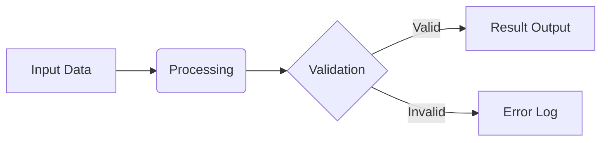
````


### Basic Syntax Rules
- **Comments**: Any line starting with `%%` is treated as a comment and ignored during rendering.
- **Case Sensitivity**: Diagram keywords (e.g., `flowchart`, `sequenceDiagram`, `classDiagram`) are generally case-sensitive or standard lowercase.
- **Node IDs vs Labels**: Node IDs are identifiers (e.g. `node1`), whereas brackets define the rendered visual label (e.g. `node1["Friendly Name"]`).
- **Whitespace**: Whitespace and indentations are ignored in most diagrams, except for indentation-sensitive diagrams like `mindmap`.

---

## 2. Global Directives, Themes, and Configuration

Mermaid allows in-diagram configuration using **frontmatter** YAML directives or inline `%%{init: ...}%%` directives placed at the top of the diagram.

### Built-in Themes
Mermaid provides 5 primary themes:
1. `default`: Standard theme with neutral blues and greens.
2. `forest`: Natural green and earth palette.
3. `dark`: High-contrast dark mode.
4. `neutral`: Monochrome and grayscale styling.
5. `base`: Minimal bare-bones palette designed for custom CSS/variable overrides.

### Applying Themes with Inline Directive

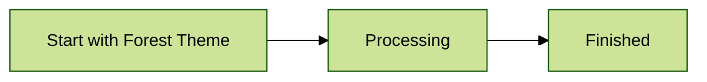

### Deep Customization with `themeVariables`

You can customize colors, fonts, borders, and backgrounds per diagram type:

```mermaid
%%{init: {
  'theme': 'base',
  'themeVariables': {
    'primaryColor': '#4f46e5',
    'primaryTextColor': '#ffffff',
    'primaryBorderColor': '#312e81',
    'lineColor': '#f59e0b',
    'secondaryColor': '#9948ec',
    'tertiaryColor': '#131416'
  }
}}%%
flowchart LR
    subgraph Tertiary[Tertiary color: subgraph background]
        A[Primary color] -->|Secondary color| B{}
    end
```

---

## 3. Flowcharts (`flowchart` / `graph`)

Flowcharts are the most versatile diagram type in Mermaid. While `graph` is the legacy keyword, `flowchart` is recommended because it supports richer shapes, markdown strings, and advanced edge routing.

### Direction & Orientation

| Directive | Meaning |
| :--- | :--- |
| `TB` or `TD` | Top to Bottom / Top Down |
| `BT` | Bottom to Top |
| `LR` | Left to Right |
| `RL` | Right to Left |

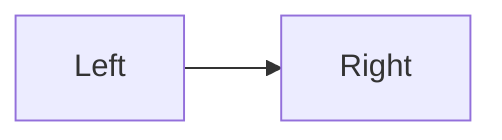

### All Node Shapes

Mermaid supports 13+ distinct node bounding shapes:

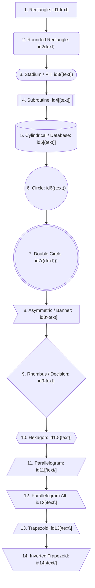

### All Line & Arrow Connectors

Mermaid supports extensive link types, multi-line connectors, text labels, and custom line lengths:

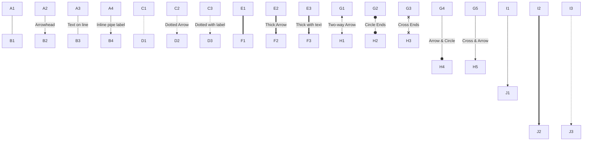

### Subgraphs & Direction Control

Subgraphs group nodes logically. Each subgraph can maintain its own independent flow direction:

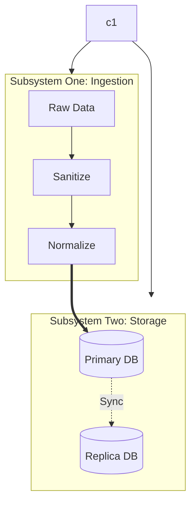

### Nested Subgraphs

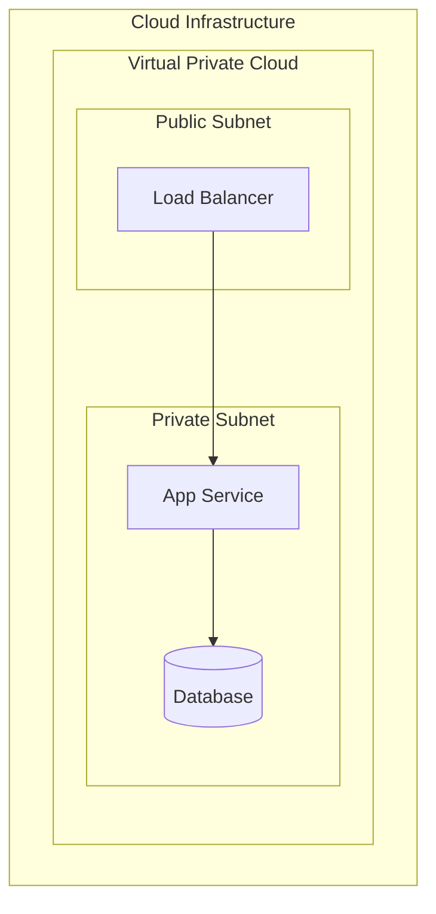

### Styling, CSS Classes, & Link Styling

Mermaid provides 4 ways to style flowchart elements:
1. **Direct `style`**: Applies inline CSS properties directly to a specific node ID.
2. **`classDef` & `class`**: Reusable class definitions assigned to multiple nodes.
3. **Class Shorthand (`:::`)**: Suffix notation appending classes directly during node declaration.
4. **`linkStyle`**: Targets connectors by index (0-indexed order of appearance).

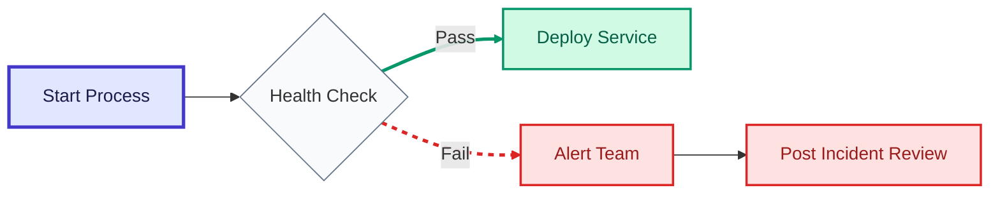

### Interactivity: Hyperlinks & Tooltips

Nodes can trigger browser events, open URLs in new tabs, or display hover tooltips:

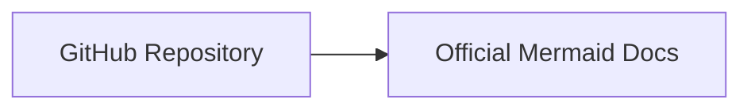

### Markdown String Formatting & FontAwesome Icons

Flowchart nodes enclosed in backtick strings `["`...`"]` render formatted Markdown (bold, italic, code blocks, lists, and line breaks):

```mermaid
flowchart TD
    mdNode["`**Bold Header**
    *Italic text description*
    \`code_function()\`
    - Item 1
    - Item 2`"]

    iconNode["fa:fa-server Compute Node"]
    dbNode["fa:fa-database Storage Engine"]

    mdNode --> iconNode --> dbNode
```

---

## 4. Sequence Diagrams (`sequenceDiagram`)

Sequence diagrams illustrate interactions between participants over time, proceeding from top to bottom.

### Participants, Actors, & Aliases

- `actor`: Displays a human stick-figure icon.
- `participant`: Displays a rectangular component box.
- `as`: Renames a component for easier referencing.

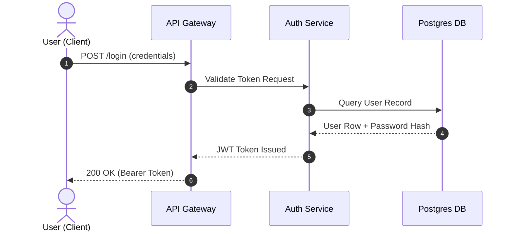

### All Message & Arrow Types

Mermaid sequence diagrams support 8 distinct message line and arrow styles:

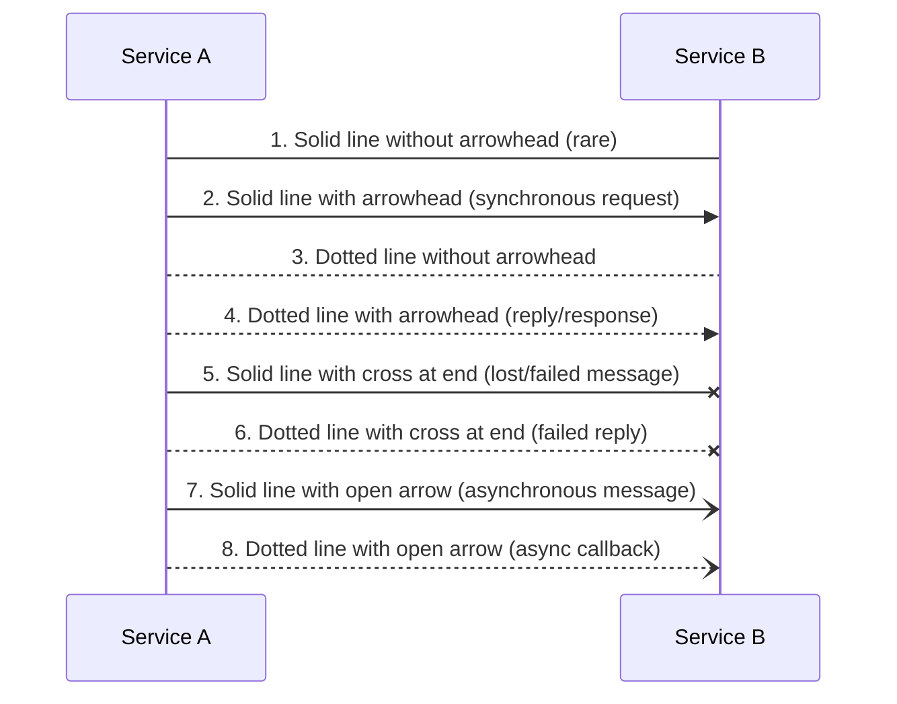

### Activations & Deactivations

Activations represent active execution time. Use `activate` / `deactivate` or the shorthand `+` and `-` on arrows:

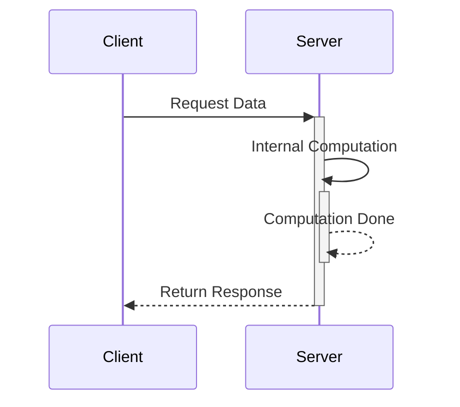

### Notes & Positioning

Notes can be placed on the left, right, or across multiple participants:

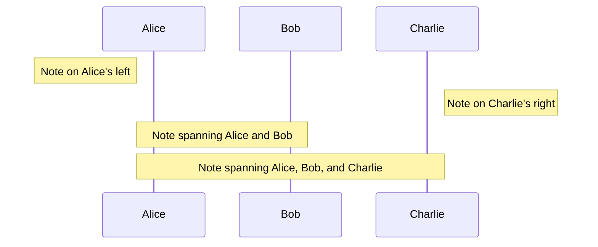

### Loops, Conditionals, & Parallel Blocks

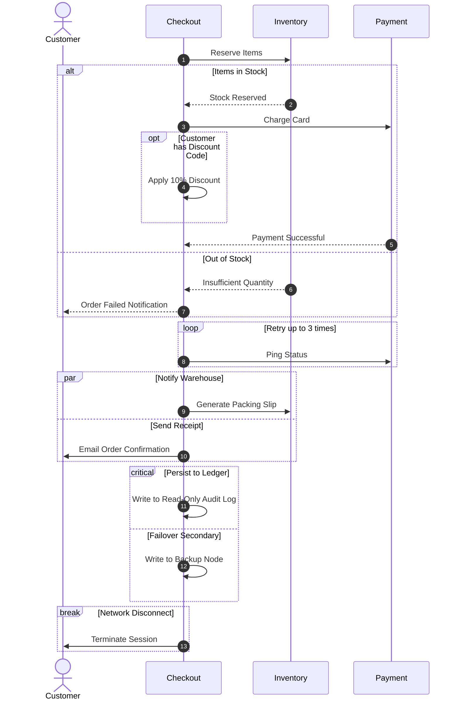

### Background Shading (`rect`) & Box Grouping (`box`)

Use `box` to visually cluster related microservices, and `rect` to highlight critical communication zones:

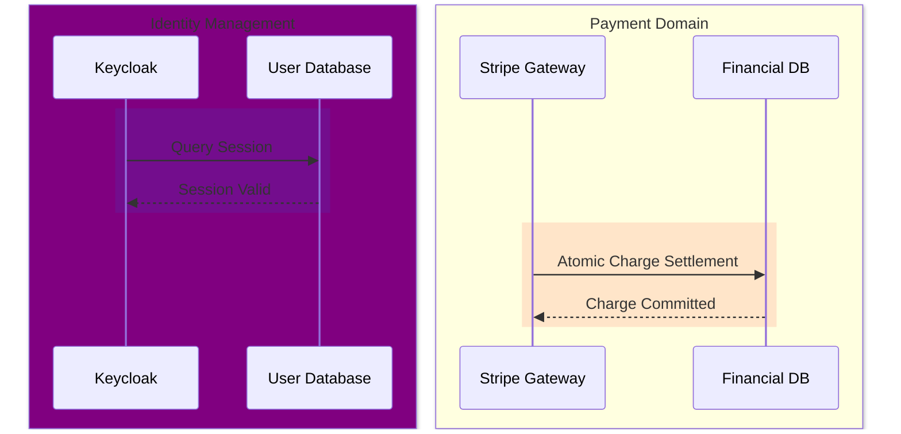

---

## 5. Class Diagrams (`classDiagram` / `classDiagram-v2`)

Class diagrams illustrate object-oriented models, inheritance trees, interfaces, and structural dependencies.

### Class Definitions, Attributes, & Methods

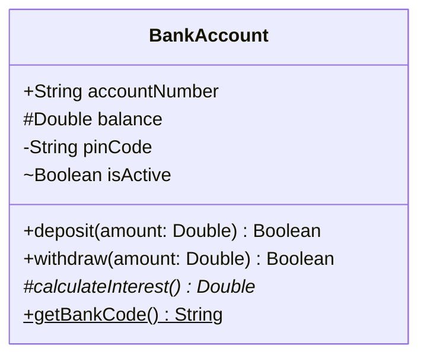

### Visibility Indicators & Classifiers

| Symbol | Visibility / Modifier | Description |
| :---: | :--- | :--- |
| `+` | **Public** | Accessible by any class |
| `-` | **Private** | Accessible only within declaring class |
| `#` | **Protected** | Accessible within declaring and derived classes |
| `~` | **Package / Internal** | Accessible within the same namespace/package |
| `*` | **Abstract Method** | Must be implemented by non-abstract subclasses |
| `$` | **Static Member** | Belongs to class rather than instance |

### All Relationship Types & Multiplicity

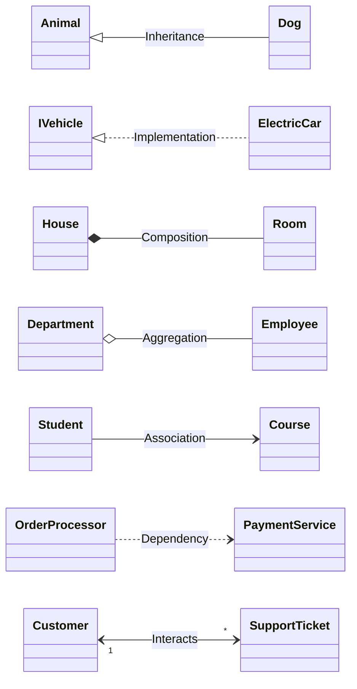

### Multiplicity Strings
Multiplicities represent cardinality ranges:
- `"1"`: Exactly one
- `"0..1"`: Zero or one
- `"1..*"`: One or more
- `"*"` or `"0..*"`: Zero or more
- `"n"`: Specific count

### Generics / Parameterized Types

Enclose type parameters within tildes (`~T~`):

```mermaid
classDiagram
    class Repository~T~ {
        +findById(id: Long) T
        +save(entity: T) Boolean
        +getAll() List~T~
    }

    class UserRepository {
        +findByEmail(email: String) User
    }

    Repository~User~ <|-- UserRepository
```

### Annotations (`<<interface>>`, `<<abstract>>`, `<<service>>`, `<<enumeration>>`)

Annotations classify types at the top of the class box:

```mermaid
classDiagram
    class OrderStatus {
        <<enumeration>>
        PENDING
        PAID
        SHIPPED
        CANCELLED
    }

    class IRepository~T~ {
        <<interface>>
        +find(id: String) T
    }

    class AbstractWorker {
        <<abstract>>
        +execute()* void
    }

    class PaymentService {
        <<service>>
        +process() void
    }
```

---

## 6. State Diagrams (`stateDiagram-v2`)

State diagrams model the lifecycle of entities as they transition across discrete states in response to internal and external events.

### States, Transitions, & Actions

```mermaid
stateDiagram-v2
    [*] --> Idle : System Boot

    Idle --> Authenticating : User Submits Credentials
    Authenticating --> ActiveSession : Valid Credentials / Generate Token
    Authenticating --> LockedOut : 3 Invalid Attempts / Lock Account

    ActiveSession --> Idle : User Logout
    LockedOut --> Idle : Admin Unlock / Reset Counter

    ActiveSession --> [*] : Terminate Daemon
```

### Composite & Nested States

States can contain nested sub-state machines:

```mermaid
stateDiagram-v2
    [*] --> Operational

    state Operational {
        [*] --> NormalMode
        NormalMode --> DegradedMode : Error Rate > 5%
        DegradedMode --> NormalMode : Health Restored
        
        state DegradedMode {
            [*] --> ReadOnly
            ReadOnly --> CacheOnly : DB Unreachable
        }
    }

    Operational --> Maintenance : Admin Command
    Maintenance --> Operational : Maintenance Complete
```

### Choice, Fork, & Join Pseudo-States

- `<<choice>>`: Dynamic branching based on evaluated conditions.
- `<<fork>>`: Concurrent path split.
- `<<join>>`: Synchronization point waiting for all concurrent branches.

```mermaid
stateDiagram-v2
    state CheckCredit <<choice>>
    state ForkBranch <<fork>>
    state JoinBranch <<join>>

    [*] --> CheckCredit
    CheckCredit --> Rejected : Credit Score < 600
    CheckCredit --> Approved : Credit Score >= 600

    Approved --> ForkBranch : Spawn Tasks
    
    ForkBranch --> ProvisionAccount
    ForkBranch --> OrderDebitCard
    ForkBranch --> SendWelcomeEmail

    ProvisionAccount --> JoinBranch
    OrderDebitCard --> JoinBranch
    SendWelcomeEmail --> JoinBranch

    JoinBranch --> ReadyState : All Tasks Finished
    ReadyState --> [*]
```

### Concurrency / Parallel States

Use `--` to split a state into independent, concurrent execution tracks:

```mermaid
stateDiagram-v2
    [*] --> ActivePlayer

    state ActivePlayer {
        state AudioPlayback {
            [*] --> Playing
            Playing --> Paused : Pause Button
            Paused --> Playing : Resume Button
        }
        --
        state VisualDisplay {
            [*] --> StandardScreen
            StandardScreen --> Fullscreen : Maximize
            Fullscreen --> StandardScreen : Escape
        }
    }
```

### History States (`[H]`, `[H*]`)

History states remember the most recent active sub-state when an interrupt occurs:

```mermaid
stateDiagram-v2
    [*] --> ActiveApp

    state ActiveApp {
        [*] --> WritingEditor
        WritingEditor --> Compiling
        Compiling --> Debugging
        Debugging --> [H]
    }

    ActiveApp --> PhoneCallInterrupt : Incoming Call
    PhoneCallInterrupt --> ActiveApp : Call Hangup (Resumes via [H])
```

---

## 7. Entity Relationship Diagrams (`erDiagram`)

ER diagrams represent data schemas, relational models, primary/foreign key attributes, and relationship constraints.

### Entities, Attributes, Types, & Keys

```mermaid
erDiagram
    CUSTOMER {
        uuid id PK "Primary key"
        string username UK "Unique login name"
        string password_hash
        string email
        timestamp created_at
    }

    ORDER {
        int order_id PK
        uuid customer_id FK "References CUSTOMER.id"
        decimal total_amount
        string status
    }

    ORDER_ITEM {
        int item_id PK
        int order_id FK "References ORDER.order_id"
        int product_id FK "References PRODUCT.id"
        int quantity
        decimal unit_price
    }

    PRODUCT {
        int id PK
        string sku UK
        string title
        decimal price
    }

    CUSTOMER ||--o{ ORDER : "places"
    ORDER ||--|{ ORDER_ITEM : "contains"
    PRODUCT ||--o{ ORDER_ITEM : "ordered in"
```

### All Relationship Cardinalities

The syntax uses two symbols on each side of the relationship connector:

| Left Symbol | Right Symbol | Meaning | Description |
| :---: | :---: | :--- | :--- |
| `\|\|` | `\|\|` | Exactly one to Exactly one | Mandatory 1-to-1 |
| `\|\|` | `o\|` | Exactly one to Zero or one | Optional 1-to-1 |
| `\|\|` | `o{` | Exactly one to Zero or many | Standard 1-to-Many |
| `\|\|` | `\|{` | Exactly one to One or many | Mandatory 1-to-Many |
| `}o` | `o{` | Zero or many to Zero or many | Optional Many-to-Many |
| `}\|` | `\|{` | One or many to One or many | Mandatory Many-to-Many |

```mermaid
erDiagram
    %% One-to-One
    PERSON ||--|| PASSPORT : "holds"
    
    %% One-to-Many (Optional)
    AUTHOR ||--o{ BOOK : "writes"

    %% One-to-Many (Mandatory)
    COMPANY ||--|{ EMPLOYEE : "employs"

    %% Many-to-Many
    STUDENT }o--o{ COURSE : "enrolls in"
```

### Identifying vs Non-Identifying Relationships
- **Identifying relationship** (`--` solid line): The child entity cannot exist without the parent (child table includes parent's key in its primary key).
- **Non-identifying relationship** (`..` dotted line): The child entity maintains an independent identity.

```mermaid
erDiagram
    BUILDING ||--|{ ROOM : "identifying"
    DEPARTMENT ||..o{ ASSET : "non-identifying"
```

---

## 8. Gantt Charts (`gantt`)

Gantt charts schedule project milestones, track deliverables, map dependencies, and mark critical path activities.

```mermaid
gantt
    dateFormat  YYYY-MM-DD
    title       Enterprise Software Launch Roadmap
    excludes    weekends

    section Discovery & Architecture
    User Research          :done,    des1, 2026-01-01, 2026-01-15
    Architecture Blueprint :done,    des2, after des1, 10d
    Sign-off Milestone     :milestone, m1, after des2, 0d

    section Development
    Core Engine API        :active,  dev1, 2026-01-26, 25d
    Frontend Dashboard     :crit, active, dev2, 2026-02-05, 20d
    Integration & Tests    :crit,    dev3, after dev1 dev2, 10d

    section Deployment & QA
    Security Audit         :         qa1,  after dev3, 7d
    Staging Smoke Test     :         qa2,  after qa1, 5d
    Production Go-Live     :milestone, m2, after qa2, 0d
```

### Task Status Flags
- `done`: Grayed out / marked as completed.
- `active`: Highlighted as currently in progress.
- `crit`: Critical path task (highlighted in red).
- `milestone`: Zero-duration milestone marker.
- `after <id>`: Establishes a strict chronological predecessor dependency.

---

## 9. Git Graphs (`gitGraph`)

Git graphs visualize branching strategies (GitFlow, Trunk-Based Development), commit histories, tags, merges, and cherry-picks.

```mermaid
gitGraph
    commit id: "Initial Commit"
    commit id: "Setup Config" tag: "v0.1.0"
    
    branch feature/auth
    checkout feature/auth
    commit id: "Create Auth Controller"
    commit id: "Add JWT Middleware"
    
    checkout main
    commit id: "Fix Security Vulnerability" type: HIGHLIGHT
    
    checkout feature/auth
    merge main id: "Merge main into auth"
    commit id: "Complete Auth Integration"
    
    checkout main
    merge feature/auth id: "Merge PR #42" tag: "v1.0.0"
    
    branch hotfix/patch-1
    checkout hotfix/patch-1
    commit id: "Hotfix DB Timeout" type: REVERSE
    
    checkout main
    cherry-pick id: "Hotfix DB Timeout"
    commit id: "Release Patch" tag: "v1.0.1"
```

### Commit Types
- `NORMAL` (default): Standard commit circle.
- `REVERSE`: Displays a cross inside the commit marker (used for reverts or rollbacks).
- `HIGHLIGHT`: Highlights the node with distinct fill (used for key milestones, releases, or hotfixes).

---

## 10. Mindmaps (`mindmap`)

Mindmaps organize brainstorming concepts, functional breakdowns, and knowledge domains hierarchically using clean tab/space indentation.

```mermaid
mindmap
  root((Cloud Architecture))
    Compute
      Containers
        [Kubernetes]
        [Docker Swarm]
      Serverless
        (AWS Lambda)
        (Cloud Functions)
      Virtual Machines
    Storage
      Object Storage
        )S3 Buckets(
        )GCS Storage(
      Block Storage
      Databases
        ::icon(fa fa-database)
        ((Postgres SQL))
        ((MongoDB))
    Security
      Identity
        [OAuth 2.0 / OIDC]
        [Role Based Access]
      Networking
        {{VPC Peering}}
        {{Firewall Rules}}
```

### Mindmap Node Shapes

| Syntax | Rendered Shape |
| :--- | :--- |
| `((text))` | Circle |
| `(text)` | Rounded Rectangle |
| `[text]` | Square / Rectangle |
| `)text(` | Cloud Shape |
| `))text((` | Bang / Explosion Shape |
| `{{text}}` | Hexagon |

---

## 11. Timeline Diagrams (`timeline`)

Timelines showcase historical milestones, version releases, or phased project roadmaps grouped into distinct chronological eras.

```mermaid
timeline
    title Evolution of Web Frontend Engineering
    section 1990s : The Static Era
        1991 : World Wide Web opened to public
        1995 : JavaScript invented
        1996 : CSS initial specification
    section 2000s : The Dynamic Web
        2004 : Gmail proves AJAX feasibility
        2006 : jQuery released
        2008 : Google Chrome & V8 engine
```

---

## 12. User Journey Diagrams (`journey`)

Journey maps track user satisfaction, emotional sentiment, and multi-user involvement across sequential experience workflows.

```mermaid
journey
    title E-Commerce Customer Purchase Journey
    section Product Discovery
      Land on homepage: 4: Customer
      Search product keyword: 3: Customer
      Filter by price and rating: 5: Customer
    section Evaluation
      Read customer reviews: 4: Customer
      Check delivery dates: 2: Customer, Warehouse
      Add item to shopping cart: 5: Customer
    section Checkout & Payment
      Enter shipping address: 3: Customer
      Input credit card: 2: Customer, Payment Gateway
      Authorize 3D Secure: 1: Customer, Bank API
    section Delivery & Support
      Receive order confirmation: 5: Customer
      Track courier dispatch: 4: Customer, Courier
      Item unboxing: 5: Customer
```

### Sentiment Scoring Scale
- `5`: Delighted / Highly Satisfied
- `4`: Satisfied / Positive
- `3`: Neutral / Expected
- `2`: Frustrated / Annoyed
- `1`: Blocked / Angry

---

## 13. Pie Charts (`pie`)

Pie charts display proportional data shares and component breakdowns.

```mermaid
pie showData
    title Global Cloud Infrastructure Market Share (Est.)
    "Amazon Web Services (AWS)" : 31
    "Microsoft Azure" : 25
    "Google Cloud Platform (GCP)" : 11
    "Alibaba Cloud" : 4
    "Other Cloud Providers" : 29
```

- `showData`: Adds the exact numeric values directly beside the slice labels in the legend.

---

## 14. Quadrant Charts (`quadrantChart`)

Quadrant charts map items against two continuous numerical axes (x and y, ranging from 0.0 to 1.0) to facilitate portfolio decisions and prioritization.

```mermaid
quadrantChart
    title Technical Debt vs Feature Value Prioritization
    x-axis "Low Development Effort" --> "High Development Effort"
    y-axis "Low User Impact" --> "High User Impact"
    quadrant-1 "Strategic Investments (Big Bets)"
    quadrant-2 "Quick Wins (High ROI)"
    quadrant-3 "Avoid / Deprioritize"
    quadrant-4 "Time Wasters / Low Value"
    
    "Refactor Legacy Auth": [0.75, 0.85]
    "Export to CSV Feature": [0.20, 0.70]
    "Dark Mode Theme": [0.25, 0.35]
    "Custom ORM Rewrite": [0.90, 0.15]
    "Fix Billing Race Condition": [0.40, 0.95]
    "Microservice Decomposition": [0.85, 0.60]
```

---

## 15. XY Charts (`xychart-beta`)

XY charts plot quantitative series (categorical bars and continuous trend lines) with dual-series visualization.

```mermaid
xychart-beta
    title "Monthly Server Load & Error Count (2026)"
    x-axis ["Jan", "Feb", "Mar", "Apr", "May", "Jun", "Jul", "Aug", "Sep", "Oct", "Nov", "Dec"]
    y-axis "Total Requests (in thousands)" 0 --> 120
    bar [45, 52, 58, 65, 78, 92, 105, 110, 95, 85, 72, 60]
    line [10, 12, 14, 15, 22, 35, 42, 38, 25, 18, 14, 11]
```

---

## 16. Requirement Diagrams (`requirementDiagram`)

Requirement diagrams support systems engineering (SysML-style) by mapping formal requirements against software/hardware components.

```mermaid
requirementDiagram

    requirement user_authentication {
        id: REQ-001
        text: System shall authenticate users via OAuth2/OIDC.
        risk: High
        verifymethod: Test
    }

    functionalRequirement rate_limiting {
        id: REQ-002
        text: API shall reject traffic exceeding 100 req/sec per IP.
        risk: Medium
        verifymethod: Analysis
    }

    element auth_gateway {
        type: Microservice
        docref: architecture/auth.md
    }

    element ingress_controller {
        type: Infrastructure
        docref: k8s/ingress.yaml
    }

    auth_gateway - satisfies -> user_authentication
    ingress_controller - satisfies -> rate_limiting
    user_authentication - traces -> rate_limiting
```

### Relationship Types in Requirements
- `- satisfies ->`: System element fulfills the requirement.
- `- verifies ->`: Test/verification element verifies the requirement.
- `- refines ->`: Adds detail or narrows down a high-level requirement.
- `- copies ->`: Clones another requirement.
- `- derives ->`: Derived from an upstream business goal.
- `- traces ->`: General bidirectional trace link.

---

## 17. C4 Architecture Diagrams (`C4Context`, `C4Container`, `C4Component`)

Mermaid natively supports the C4 model for visualizing software architecture at zoomable levels of abstraction.

### Level 1: System Context Diagram

```mermaid
C4Context
    title System Context Diagram for Retail Banking System

    Person(customer, "Personal Banking Customer", "A customer of the bank with personal bank accounts.")
    System(bankingSystem, "Internet Banking System", "Allows customers to view their balance, make payments and transfer money.")
    
    System_Ext(mailSystem, "E-mail System", "The internal Microsoft Exchange e-mail system.")
    System_Ext(mainframe, "Mainframe Banking System", "Stores all core banking information about customers, accounts, and transactions.")

    Rel(customer, bankingSystem, "Uses", "HTTPS")
    Rel_Back(customer, mailSystem, "Sends e-mails to")
    Rel(bankingSystem, mailSystem, "Sends e-mails", "SMTP")
    Rel(bankingSystem, mainframe, "Queries balance & executes transfers", "XML/HTTPS")
```

### Level 2: Container Diagram

```mermaid
C4Container
    title Container Diagram for Internet Banking System

    Person(customer, "Customer", "Registered bank customer")

    Container_Boundary(c1, "Internet Banking System") {
        Container(webApp, "Single-Page Application", "JavaScript & React", "Delivers banking GUI to browser")
        Container(apiGateway, "API Gateway", "Go / Envoy", "Handles routing, rate limits, and SSL termination")
        Container(backendApi, "Backend REST API", "Node.js & TypeScript", "Provides banking business logic")
        ContainerDb(db, "Relational Database", "PostgreSQL", "Stores customer records, transactions, and audit logs")
    }

    Rel(customer, webApp, "Visits", "HTTPS")
    Rel(webApp, apiGateway, "Makes API calls to", "JSON/HTTPS")
    Rel(apiGateway, backendApi, "Proxies requests to", "gRPC")
    Rel(backendApi, db, "Reads & writes to", "TCP/SQL")
```

---

## 18. Block Diagrams (`block-beta`)

Block diagrams allow grid-aligned structural mapping, hardware block diagrams, and multi-column architecture layouts.

```mermaid
block-beta
    columns 4
    Header["Distributed System Gateway"]:4
    
    block:Ingress:2
        columns 2
        A["Reverse Proxy"]
        B["WAF Firewall"]
    end

    block:Compute:2
        columns 2
        C["App Server 1"]
        D["App Server 2"]
    end

    Database[("Distributed Clustered Database")]:4
    
    A --> B
    B --> C
    B --> D
    C --> Database
    D --> Database
```

---

## 19. Packet Diagrams (`packet-beta`)

Packet diagrams document low-level protocol designs, network headers, and binary memory layouts.

```mermaid
packet-beta
    0-15: "Source Port (16 bits)"
    16-31: "Destination Port (16 bits)"
    32-63: "Sequence Number (32 bits)"
    64-95: "Acknowledgment Number (32 bits)"
    96-99: "Data Offset"
    100-105: "Reserved"
    106-111: "Flags (URG, ACK, PSH, RST, SYN, FIN)"
    112-127: "Window Size (16 bits)"
    128-143: "Checksum (16 bits)"
    144-159: "Urgent Pointer (16 bits)"
    160-191: "Options and Padding (Variable)"
```

---

## 20. Architecture Diagrams (`architecture-beta`)

Architecture diagrams map cloud environments, infrastructure resources, and server topologies with icon associations.

```mermaid
architecture-beta
    group cloud(cloud)[AWS Virtual Private Cloud]

    service internet(internet)[Public Internet]
    service alb(server)[Application Load Balancer] in cloud
    service api(server)[ECS API Service] in cloud
    service db(database)[Aurora PostgreSQL] in cloud

    internet:R -- L:alb
    alb:B -- T:api
    api:R -- L:db
```

---

## 21. Sankey Diagrams (`sankey-beta`)

Sankey diagrams visualize directed flows where link widths are proportional to flow quantities (energy, revenue, traffic).

```mermaid
sankey-beta
    %% Source, Target, Value
    Solar Farm, Inverter Station, 120
    Wind Farm, Inverter Station, 80
    Inverter Station, Industrial Grid, 130
    Inverter Station, Residential Grid, 50
    Inverter Station, Battery Storage Loss, 20
    Residential Grid, Electric Vehicles, 20
    Residential Grid, Home Appliances, 30
```

---

## 22. Kanban Diagrams (`kanban`)

Kanban boards organize sprint tasks, operational workflows, and backlogs directly inside markdown.

```mermaid
kanban
  Todo
    [PROJ-101: Integrate OAuth2 Login]
    [PROJ-102: Add Prometheus Metrics]
  In Progress
    [PROJ-098: Migrate MySQL to PostgreSQL]
    [PROJ-099: Implement Stripe Webhooks]
  Code Review
    [PROJ-095: Fix Session Race Condition]
  Done
    [PROJ-089: Setup Kubernetes Cluster]
    [PROJ-090: Dockerfile Multi-Stage Build]
```

---

## 23. Escapes, Markdown Strings, & Best Practices

### Escaping Reserved Characters
Mermaid reserves special characters including quotes (`"`), brackets (`[`, `]`, `(`, `)`), braces (`{`, `}`), and angle brackets (`<`, `>`).
When you need literal instances of these characters inside node labels, use one of the following methods:

#### Method 1: HTML Entities
- `&quot;` for quotation marks `"`
- `&lt;` for `<`
- `&gt;` for `>`
- `#91;` for `[`
- `#93;` for `]`
- `#40;` for `(`
- `#41;` for `)`

```mermaid
flowchart LR
    A["Raw Data #91;Unfiltered#93;"] --> B["Output &lt;JSON-Stream&gt;"]
```

#### Method 2: Backtick-Quoted Markdown Strings
Surround strings with `["`...`"]` to enable unrestricted markdown:

```mermaid
flowchart TD
    node["`Special characters like (parentheses), [brackets], and **bolding** work cleanly!`"]
```

### Avoiding Layout Degeneracy in Large Diagrams
1. **Choose the correct direction**: For wide tree hierarchies, use `TB` (top to bottom). For sequential pipelines, use `LR` (left to right).
2. **Subgraphs**: Break monolithic flows into bounded subgraphs.
3. **Use link length overrides**: In flowcharts, adding extra hyphens (`---->`, `=====>`) forces Mermaid's Dagre layout engine to introduce rank-separation and straighten crossing lines.
4. **Use unique IDs**: Always separate the semantic identity of a node (`cust_db`) from its display label (`cust_db[("Customer Records")]`).

---

## 24. Quick Reference Syntax Matrix

| Diagram Type | Primary Keyword | Typical Use Case |
| :--- | :--- | :--- |
| **Flowchart** | `flowchart TD` / `LR` | Processes, decision trees, flow control, system topologies |
| **Sequence** | `sequenceDiagram` | API interactions, network handshakes, event lifecycles |
| **Class** | `classDiagram` | Object-oriented models, domain classes, inheritance trees |
| **State** | `stateDiagram-v2` | Finite state machines, lifecycles, operational states |
| **Entity-Relationship**| `erDiagram` | Database schemas, SQL tables, foreign keys, cardinality |
| **Gantt** | `gantt` | Project timelines, roadmaps, task dependencies |
| **Git Graph** | `gitGraph` | Git branching strategies, release tags, cherry-picks |
| **Mindmap** | `mindmap` | Brainstorming, domain exploration, taxonomy breakdowns |
| **Timeline** | `timeline` | Historical milestones, multi-era event logs |
| **User Journey** | `journey` | UX workflows, customer satisfaction tracking |
| **Pie Chart** | `pie` | Proportional data shares, market compositions |
| **Quadrant Chart** | `quadrantChart` | 2x2 priority matrices, effort vs impact evaluations |
| **XY Chart** | `xychart-beta` | Categorical bar graphs and continuous line charts |
| **Requirement** | `requirementDiagram` | SysML requirement matrices and verification traces |
| **C4 Model** | `C4Context` / `C4Container` | Multi-tiered software architecture documentation |
| **Block Diagram** | `block-beta` | Structured grid layouts, hardware and subsystem blocks |
| **Packet Diagram** | `packet-beta` | Protocol headers, bit-level memory and payload maps |
| **Architecture** | `architecture-beta` | Cloud infrastructures, service clusters, network boundaries |
| **Sankey** | `sankey-beta` | Energy, cost, and data flow volume transfers |
| **Kanban** | `kanban` | Task boards, sprint deliverables, work-in-progress limits |
